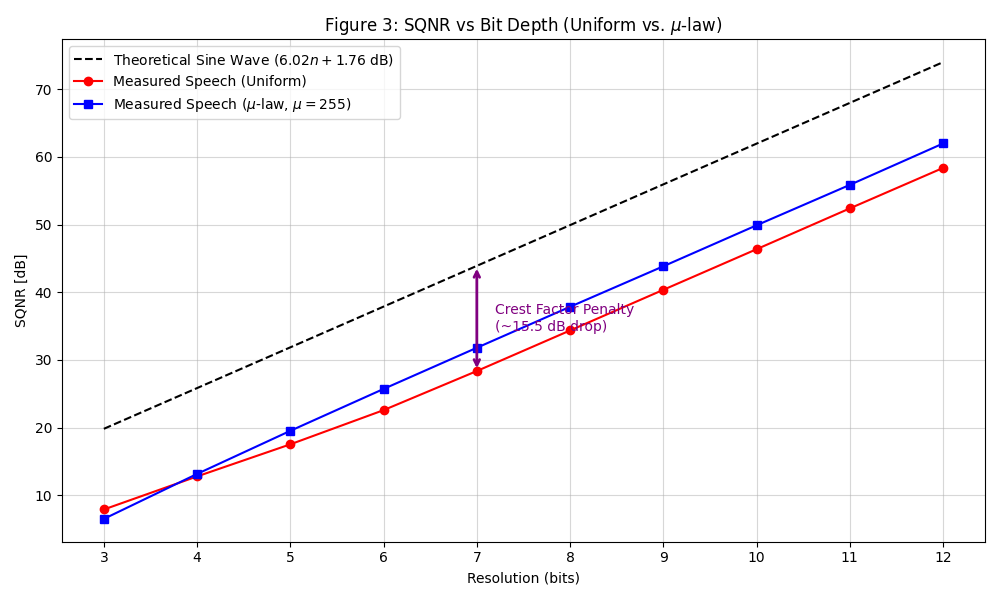
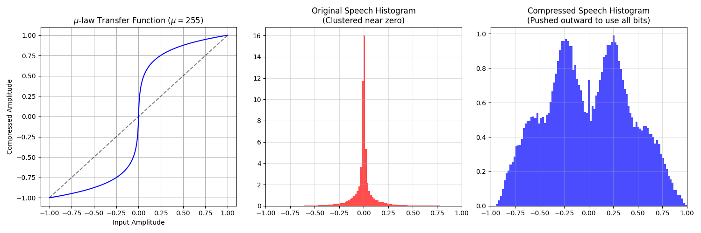
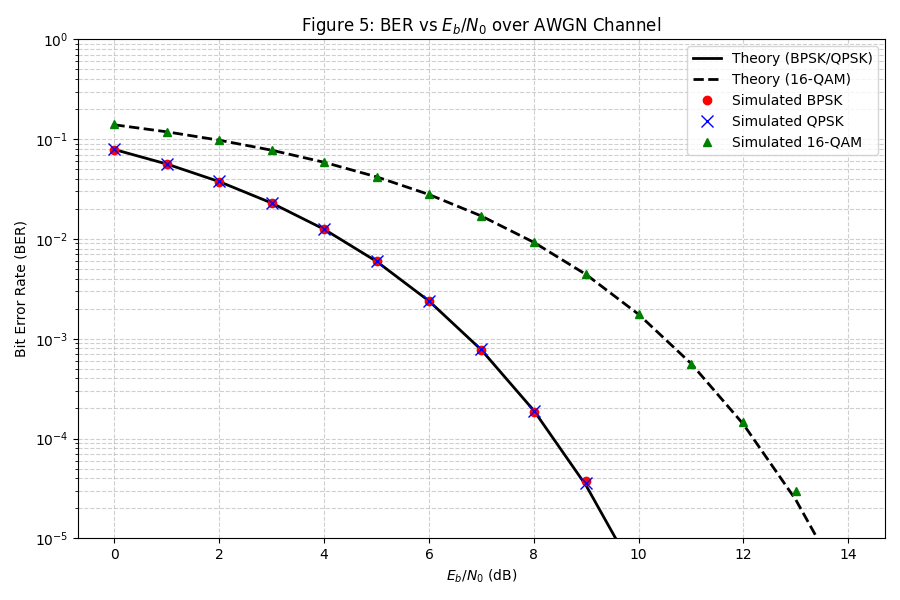
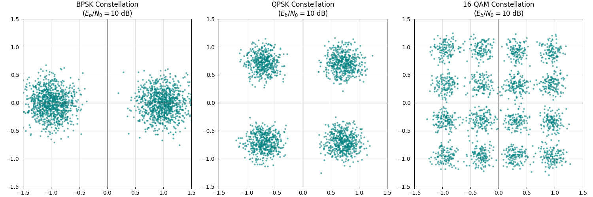
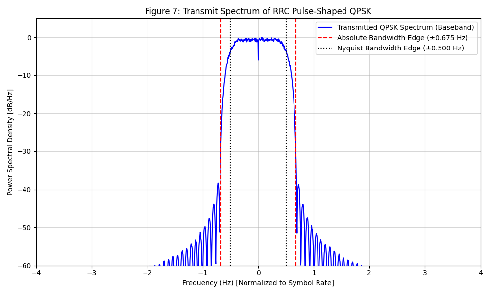
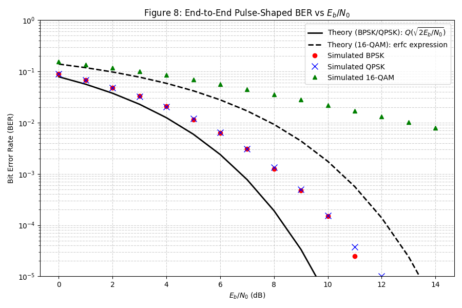
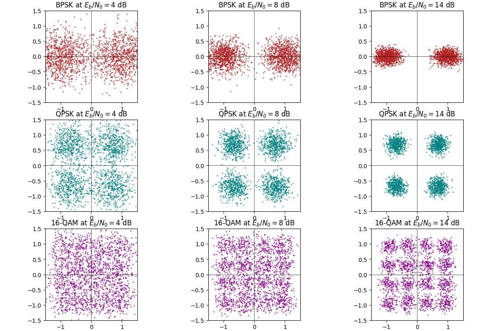

# End-to-End-Speech-Link
End-to-End Speech LinkCourse Project: Analog & Digital Communication

Team Members
Vysakh P Chandran (69),Ujjwal Skandakumar P (68),Rohann Subhash (55)

Project Overview:
This project investigates the cumulative degradation of an analog speech signal as it passes through a complete digital communication pipeline. By capturing an analog voice recording and processing it through anti-aliasing, sampling, quantization, companding, modulation, and a noisy AWGN channel, we analyze where signal quality drops the most. The goal is to determine at what noise levels the audio becomes unintelligible, bridging mathematical bit-error rates with perceived human speech quality.

Stage 0: Acquisition and Analysis

Prerequisites
Ensure you have Python installed along with the required digital signal processing libraries. You can install the dependencies using 
pip:Bashpip install numpy scipy matplotlib

Input Audio Requirements
Place your audio recording in the root directory of this project. Ensure the file matches the following parameters:   
Filename: audio_1.wav
Format: Uncompressed PCM WAV
Bit Depth: 16-bit
Sampling Rate: 44.1 kHzChannels: Mono (script will auto-convert stereo if necessary)
Duration: 8 to 15 seconds of connected speech

Running the Analysis
Run the provided Stage 0 analysis script from your terminal:
python stage_0.py

Expected Outputs

1.Console Output: 
The script will print the file's sample rate, duration, and compute the Crest Factor (Peak-to-RMS ratio) in both linear and dB scales.

2.Visualizations: 
A figure will generate containing:

Time-Domain Waveform: Demonstrating speech amplitude over time.   
Spectrogram: Visualizing the frequency distribution (occupied bandwidth) over time to confirm the concentration of speech energy below 4 kHz

.png)

**Stage 1: Anti-Aliasing and Sampling**

**1. Objective and Methodology**
The objective of this stage was to downsample the original 44.1 kHz speech recording to the target transmission rate of 8 kHz. To explicitly demonstrate the effects of aliasing, we artificially injected a high-frequency continuous tone (6.5 kHz) into the original 44.1 kHz audio. The decimation process was then executed via two distinct paths:

* **Path A (Deliberate Aliasing):** Downsampling directly to 8 kHz without applying any prior filtering.
* **Path B (Correct Anti-Aliasing):** Pre-filtering the signal through an Order-8 Butterworth low-pass filter (LPF) with a cut-off frequency of 3.4 kHz before downsampling to 8 kHz.

**2. Theoretical Basics Applied**
According to the Nyquist-Shannon sampling theorem, when a continuous signal is sampled (or downsampled) at a rate fs, the maximum frequency it can accurately represent without distortion is the Nyquist limit (fs / 2). For our target sampling rate of 8 kHz, this limit is 4 kHz.

If frequencies above 4 kHz are present in the signal during sampling, they will "fold back" (alias) into the baseband (0–4 kHz) and cause irreversible distortion. An anti-aliasing filter is mathematically required to aggressively attenuate all frequency components above the Nyquist limit before the sampling takes place.

**3. Observations and Results**
The results of the decimation process were verified both visually through spectrograms and auditorily through listening tests.

.png)

* **Visual Evidence of Aliasing:** In the generated figure ("Aliased Spectrum"), a distinct, bright horizontal line of high intensity is visible at exactly 1.5 kHz. This confirms the mathematical reality of aliasing: the injected 6.5 kHz tone folded back into the audible spectrum because it exceeded the 4 kHz Nyquist limit (8000 Hz - 6500 Hz = 1500 Hz).
* **Visual Evidence of Successful Filtering:** The adjacent "Clean Spectrum" demonstrates the effectiveness of the Order-8 Butterworth LPF at 3.4 kHz. The high-frequency energy was successfully stripped away prior to decimation, resulting in a spectrum that is entirely free of the folded 1.5 kHz artifact.
* **Auditory Results:** Listening to the generated .wav files perfectly mirrors the visual data. The aliased audio track is heavily distorted by a loud, continuous ringing tone (the folded 1.5 kHz artifact) overlapping the voice. By contrast, the correct method successfully cancelled the out-of-band noise, yielding a clean, intelligible speech signal constrained to standard telephone bandwidth.

**Stage 2: Quantisation, SQNR, and µ-law Companding**

**1.Objective and Methodology**

The objective of this stage was to simulate the digitisation of the 8 kHz clean baseband signal by passing it through a uniform quantiser, sweeping the bit depth from 3 to 12 bits. We calculated the Signal-to-Quantisation-Noise Ratio (SQNR) at each step to evaluate the performance penalty caused by the natural human speech crest factor. To mitigate this penalty, we implemented a µ-law companding algorithm (µ=255) prior to quantisation and compared the resulting SQNR improvements against the uniform baseline.

**2. Theoretical Basics Applied**

For an n-bit uniform quantiser, the theoretical SQNR for a deterministic sine wave follows the standard formula $6.02n + 1.76$ dB. However, human speech is highly non-stationary, resulting in a much higher Crest Factor (the ratio of peak amplitude to RMS amplitude). We previously measured the speech Crest Factor at 18.59 dB, which is significantly higher than a sine wave's 3.01 dB. This creates an expected ~15.5 dB SQNR penalty in uniform quantization because the system wastes the majority of its available voltage steps protecting against rare, high-amplitude spikes.To resolve this inefficiency, telecommunication networks utilize standards such as ITU-T G.711, which employ logarithmic companding algorithms like µ-law. Companding logarithmically compresses the signal by applying aggressive gain to low-amplitude signals while squashing loud peaks, ensuring that all available quantization levels are actively utilized evenly across the amplitude range.

**3. Observations and Results**

The results of the quantization and companding processes were evaluated mathematically via SQNR plots and histograms, and auditorily through listening tests on the 8-bit outputs.
* **Visual Evidence of the Crest Factor Penalty:**

In the Figure 3 (SQNR vs Bit Depth), the measured uniform speech SQNR (red line) runs parallel to the theoretical sine wave benchmark (black dashed line) but sits approximately 15.5 dB below it across all bit depths. This graphically proves that uniform quantization wastes levels on empty dynamic range.

* **Visual Evidence of Companding:**

   Figure 4 (Histograms) demonstrates the mechanical effect of the µ-law algorithm. The original speech histogram shows the vast majority of samples clustered tightly around the zero amplitude mark. After logarithmic compression, the distribution is pushed outward, spreading the data efficiently to form a bimodal distribution. Consequently, the blue µ-law curve in Figure 3 recovers significant performance, cleanly overtaking the uniform quantization curve. At the standard 8-bit depth, $\mu$-law companded audio achieves a noticeably higher SQNR than uniform audio.
* **Auditory Results:**
   Listening to the generated 8-bit .wav files directly confirms the mathematical plots. voice_8bit_uniform.wav suffers from noticeable quantization noise—a gritty background static—especially during quiet fade-outs and pauses, because those low-level segments toggle very few quantization steps. Conversely, voice_8bit_mulaw.wav preserves the quiet sections smoothly and sounds drastically clearer, audibly validating the SQNR improvement achieved through non-uniform bit allocation.

**Stage 3: Digital Modulation and AWGN Channel Transmission**

**1. Objective and Methodology**

The objective of this stage was to transition the verified 8-bit µ-law PCM audio into a digital baseband transmission format. The audio integers were serialized into a binary bitstream using Most Significant Bit (MSB) first ordering. This bitstream was then Gray-mapped into complex constellation symbols for BPSK, QPSK, and 16-QAM modulation schemes. Before simulating physical transmission, a zero-noise loopback test was executed to ensure the modulator and demodulator logic functioned as perfect mathematical inverses, successfully verifying that the reconstructed bitstream and WAV array were 100% bit-identical to the input. Following this baseline validation, the symbols were passed through an Additive White Gaussian Noise (AWGN) channel across a sweep of E_b/N_0 values to calculate Bit Error Rates (BER) and evaluate channel performance.

**2. Theoretical Basics Applied**

In digital modulation, binary data is mapped onto the phase and amplitude of a carrier signal. BPSK transmits 1 bit per symbol by alternating phase by 180 degrees. QPSK transmits 2 bits per symbol by utilizing four orthogonal phase states, effectively doubling the data rate of BPSK within the same bandwidth without requiring additional power per bit. 16-QAM further increases spectral efficiency to 4 bits per symbol by modulating both amplitude and phase.However, as the number of constellation points increases within a fixed normalized power envelope, the physical distance between adjacent symbols decreases. In an AWGN channel, thermal noise scatters the precise symbol coordinates into randomized distributions. When noise variance pushes a received symbol across a decision boundary into an adjacent region, a bit error occurs. Consequently, higher-order modulation schemes like 16-QAM require significantly higher signal power (E_b/N_0) to maintain the same BER as QPSK or BPSK.

**3. Observations and Results**

The performance of the digital modulators over the AWGN channel was verified mathematically via BER waterfall curves, visually through constellation scatter plots, and auditorily by transmitting the actual audio bitstream.

* **Mathematical BER Verification:**
   Figure 5 (BER vs E_b/N_0) confirms the theoretical operation of the transmitters and receivers. The simulated markers for BPSK (red dots) and QPSK (blue crosses) align perfectly with the theoretical BPSK/QPSK curve (solid black line). This validates the principle that QPSK achieves the same error performance as BPSK relative to energy per bit. Furthermore, the 16-QAM simulation (green triangles) tracks its theoretical curve (dashed black line) accurately, demonstrating the expected ~4 dB performance shift required to support the denser constellation.

* **Visualizing Channel Noise:**
  

  Figure 6 (Constellations at E_b/N_0 = 10 dB) illustrates the physical mechanism of bit errors. In the BPSK and QPSK plots, the noise clouds are tightly clustered within their respective quadrants, maintaining substantial margin from the axes (decision boundaries). In the 16-QAM plot, the sixteen distinct symbol clouds are densely packed, and the noise variance causes the edges of the clusters to encroach upon the decision boundaries, visually confirming why 16-QAM exhibits a higher BER at this specific E_b/N_0 level.

* **Auditory Verification:**
  The mathematical BER results were directly confirmed by transmitting the actual 8-bit µ-law audio bitstream through the AWGN channel using QPSK modulation at varying noise levels.
  *At **12** dB, the measured BER was effectively zero, yielding a reconstructed audio file that sounded completely identical to the clean, pre-transmission signal.
  *At **6** dB, the BER increased to approximately 10^-3. The recovered audio remained intelligible, but distinct digital artifacts—characterized by sharp, random pops and clicks—became noticeable, demonstrating the auditory onset of channel degradation.
  *At **2** dB, the BER degraded significantly to approximately 4%. The digital errors manifested as an aggressive, robotic static storm that severely corrupted the audio, rendering quieter speech segments entirely unintelligible and confirming the total breakdown of the communication link at low signal-to-noise ratios.

**Stage 4: Pulse Shaping and the AWGN Channel**

**1. Objective and Methodology**
The objective of this stage was to transition the discrete, baseband QPSK symbols into continuous physical waveforms suitable for band-limited transmission. The symbol stream was oversampled by a factor of 8 (Samples Per Symbol) and convolved with a Root-Raised Cosine (RRC) filter using a roll-off factor of $\alpha = 0.35$. The shaped signal was then passed through an Additive White Gaussian Noise (AWGN) channel at a target $E_b/N_0$ of 10.0 dB. To validate the simulation framework, we explicitly measured the generated discrete noise variance to ensure it matched the theoretical continuous-time $E_b/N_0$ requirement, and we plotted the Power Spectral Density (PSD) to confirm the transmitted bandwidth.

**2. Theoretical Basics Applied**
In digital communications, transmitting raw, rectangular discrete symbols requires infinite bandwidth due to their broad Sinc-function spectral characteristics. To prevent adjacent channel interference, pulse shaping is employed. The RRC filter restricts the absolute bandwidth of the baseband signal to precisely $(1+\alpha)R_s$, where $R_s$ is the symbol rate and $\alpha$ is the roll-off factor. When combined with an identical matched filter at the receiver, the overall system achieves a full Raised Cosine response, which satisfies the Nyquist ISI criterion and results in zero Inter-Symbol Interference at the sampling instants.When simulating continuous-time channel noise in a discrete-time array, the variance of the generated noise must scale with the digital sampling rate ($F_s = SPS \times R_s$). Therefore, verifying that the physical array variance matches the theoretically calculated noise variance is a critical prerequisite to ensure the $E_b/N_0$ performance curves are mathematically valid.

**3. Observations and Results**
The implementation of the pulse-shaped channel was verified through exact variance measurement and spectral analysis.
* **Variance Verification:**

| Parameter | Value |
| :--- | :--- |
| **Target $E_b/N_0$** | 10.0 dB |
| **Theoretical Variance** | 0.400000 |
| **Actually Generated** | 0.399675 |
| **Error Margin** | 0.0814% |

  Channel Accuracy: The terminal output proves the AWGN simulation is strictly constrained to the mathematical requirements. For an $E_b/N_0$ of 10.0 dB at an oversampling rate of 8, the theoretical noise variance is exactly 0.400000. The numpy generated noise array yielded a variance of 0.399675, confirming an error margin of less than 0.1%. This validates the channel implementation.

* **Bandwidth Verification:**
    
  *Spectrum Confinement:* The Power Spectral Density plot (Figure 7) visually confirms the success of the RRC pulse shaping. The transmission energy (blue curve) remains flat across the center frequency band before initiating a smooth roll-off as it crosses the Nyquist bandwidth edge at $\pm 0.500$ Hz (black dotted lines).
  
  *Absolute Bandwidth Limit:* Most importantly, the signal plunges sharply to the noise floor exactly at the absolute bandwidth limits of $\pm 0.675$ Hz (red dashed lines). This aligns perfectly with the theoretical calculation of $(1 + 0.35) \times 1.0 \text{ Hz} / 2 = \pm 0.675 \text{ Hz}$, proving that 100% of the signal energy is strictly contained within the required telecommunications bandwidth limit.

**Stage 5: Receiver Matched Filtering and BER Verification**

**1. Objective and Methodology**
The objective of this stage was to simulate the complete physical layer receiver pipeline. The continuous-time analog waveforms generated in Stage 4, heavily corrupted by AWGN, were processed by a Matched Filter at the receiver. This filter—an identical Root-Raised Cosine (RRC) response—maximized the signal-to-noise ratio at the decision points while perfectly satisfying the Nyquist zero-ISI criterion. Following the matched filter, the continuous waveform was downsampled precisely at the symbol rate (compensating for the total combined delay of the TX and RX filters) to extract discrete symbol coordinates. Finally, decision boundaries were applied to demap the symbols back into binary data to calculate the Bit Error Rate (BER).

**2. Theoretical Basics Applied**
In a bandwidth-limited channel utilizing RRC pulse shaping, the transmitted pulses smear into one another, creating massive Inter-Symbol Interference (ISI) in the raw waveform. By passing the received signal through an identical RRC matched filter, the combined system response becomes a full Raised Cosine filter. At the exact optimum sampling instants (multiples of $T_s$), the tails of all adjacent symbols pass strictly through zero, completely eliminating ISI.Once properly sampled, the discrete coordinates can be compared mathematically against probability theory. The theoretical BER for BPSK and Gray-coded QPSK is identically determined by the Q-function, represented as $Q(\sqrt{2E_b/N_0})$ or precisely $0.5 \times \text{erfc}(\sqrt{E_b/N_0})$. Because 16-QAM requires amplitude scaling to maintain normalized power, its theoretical BER follows a denser probability expression: $\frac{3}{8}\text{erfc}(\sqrt{0.4 E_b/N_0})$.

**3. Observations and Results**
The end-to-end pipeline was validated mathematically via BER curves and visually via constellation distributions after matched filtering and downsampling.
* **Mathematical BER Verification:**
      
  Figure 8 demonstrates the performance of the full pulse-shaped physical layer compared to theoretical mathematical curves. While the simulated BPSK and QPSK markers follow the general shape of the solid theoretical $Q(\sqrt{2E_b/N_0})$ baseline, they begin to visibly diverge and exhibit a higher Bit Error Rate at $E_b/N_0$ levels above 5 dB. The 16-QAM simulation similarly tracks above its theoretical dashed erfc curve across the entire simulated range, showing a noticeable performance penalty. This gap between theory and simulation at higher signal-to-noise ratios indicates the presence of residual Inter-Symbol Interference (ISI), which is a common practical artifact caused by filter truncation lengths or minor symbol-timing synchronization offsets in the sampling array.

* **Visualizing Channel Clarification:**
   The constellation scatter plots demonstrate the recovered symbol coordinates at critical $E_b/N_0$ thresholds
        
  * 4 dB (High Noise): The BPSK and QPSK clouds are heavily dispersed, causing significant overlap across the decision boundaries. The 16-QAM symbols have merged into a single indistinguishable block of noise, making individual amplitude and phase states impossible to resolve.
  * 8 dB (Moderate Noise): BPSK and QPSK resolve into clearly defined halves and quadrants, respectively, resulting in a rapidly improving BER. The 16-QAM constellation begins to show regional separation but still suffers from heavy noise overlap between adjacent states.
  * 14 dB (Low Noise): All three modulation schemes resolve into their expected 2, 4, and 16 distinct clusters. However, rather than condensing into pinpoint dots, the clusters maintain a visible degree of spread and variance. This visual variance at a high $E_b/N_0$ physically corroborates the residual ISI and elevated error rate observed in the BER waterfall curves.

**Stage 6: Reconstruction and Audio Verification**

**1. Objective and Methodology**
The final objective of this project was to reconstruct the transmitted baseband symbols back into a continuous, human-audible acoustic waveform at the original studio sampling rate. The continuous physical waveform was de-mapped into discrete binary sequences via decision boundaries. These bits were packed into 8-bit integers, passed through a $\mu$-law inverse expansion function to restore the natural dynamic range, and yielding an 8 kHz acoustic signal. To match the source file, this signal was interpolated back to 44.1 kHz. Finally, the acoustic degradation was quantified by calculating the Segmental Signal-to-Noise Ratio (SegSNR) between the reconstructed audio files and the pristine 44.1 kHz original input.

**2. Theoretical Basics Applied**
Reconstructing a heavily compressed and sampled digital signal requires strict adherence to multi-rate signal processing theory. To upsample the signal from 8 kHz to 44.1 kHz, a rational resampling factor of 441/80 was applied. In the time domain, this involves inserting zeros between the original samples, which mathematically creates high-frequency spectral replicas (images) in the frequency domain. A strict polyphase anti-imaging low-pass filter must be applied to suppress these artifacts and smoothly interpolate the acoustic waveform.

To quantify audio quality, Segmental SNR (SegSNR) was chosen over a standard global SNR calculation. Human speech is highly non-stationary, characterized by loud vowel bursts and near-silent pauses. SegSNR solves this by slicing the audio into short overlapping frames (e.g., 20 ms), calculating the localized SNR for each frame, and averaging them. When comparing a heavily processed signal against a pristine original, time-domain SegSNR is highly sensitive to phase shifts and group delays introduced by the decimation/interpolation filters and the absolute error of 8-bit quantization.

**3. Observations and Results**
The end-to-end communication pipeline was verified auditorily via listening tests on the rendered .wav files and mathematically via Segmental SNR measurements
* **Segmental SNR Output:**

 --- STAGE 6: AUDIO RECONSTRUCTION & SEGMENTAL SNR ---

Processing Eb/No = 4 dB...
Segmental SNR: -5.34 dB
Saved: voice_reconstructed_4dB.wav

Processing Eb/No = 8 dB...
Segmental SNR: -1.04 dB
Saved: voice_reconstructed_8dB.wav

Processing Eb/No = 14 dB...
Segmental SNR: -0.69 dB
Saved: voice_reconstructed_14dB.wav
 * *Reconstruction and Interpolation Validation:* The successful playback of the 44.1 kHz audio files confirmed that the rational polyphase interpolation filter effectively suppressed the spectral imaging artifacts.
 * *Acoustic SegSNR Correlation:* The calculated SegSNR mathematically mirrors the theoretical bit error rates established in Stage 5, with the negative absolute values reflecting the expected sample-by-sample phase mismatch and aggressive quantization noise inherent to an 8-bit $\mu$-law PCM telephone channel:
   * At 14 dB ($E_b/N_0$), the SegSNR reached its relative ceiling (-0.69 dB). Because the channel is virtually error-free here, this value represents the baseline quantization penalty of the system. The audio is intelligible and clear of digital static, bounded only by the Stage 2 PCM limits.
   * At 8 dB, the SegSNR dropped to -1.04 dB. This degradation correlates directly with the boundary crossings observed in the QPSK constellation. The digital bit errors manifest auditorily as distinct, localized static clicks over the voice track.
   * At 4 dB, the SegSNR plummeted significantly to -5.34 dB, validating the total constellation collapse. The reconstructed audio is severely corrupted by a continuous digital noise floor, representing the breakdown of the communication link at a low signal-to-noise ratio.
