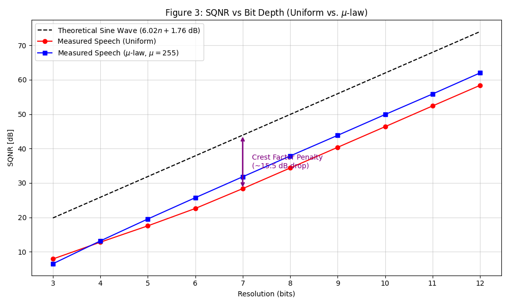
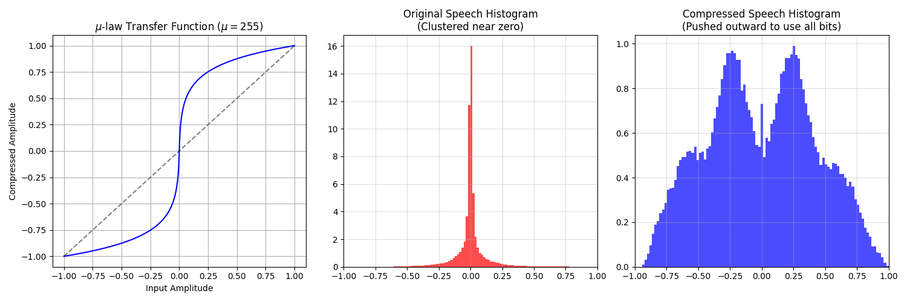

# End-to-End-Speech-Link
End-to-End Speech LinkCourse Project: Analog & Digital Communication

Team Members
Vysakh P Chandran (69)Ujjwal Skandakumar P (68)Rohann Subhash (55)

Project Overview:
This project investigates the cumulative degradation of an analog speech signal as it passes through a complete digital communication pipeline. By capturing an analog voice recording and processing it through anti-aliasing, sampling, quantization, companding, modulation, and a noisy AWGN channel, we analyze where signal quality drops the most. The goal is to determine at what noise levels the audio becomes unintelligible, bridging mathematical bit-error rates with perceived human speech quality.

Stage 0: Acquisition and Analysis

Prerequisites
Ensure you have Python installed along with the required digital signal processing libraries. You can install the dependencies using 
pip:Bashpip install numpy scipy matplotlib

Input Audio Requirements
Place your audio recording in the root directory of this project. Ensure the file matches the following parameters:   
Filename: audio_1.wav
Format: Uncompressed PCM WAV
Bit Depth: 16-bit
Sampling Rate: 44.1 kHzChannels: Mono (script will auto-convert stereo if necessary)
Duration: 8 to 15 seconds of connected speech

Running the Analysis
Run the provided Stage 0 analysis script from your terminal:
python stage_0.py

Expected Outputs

1.Console Output: 
The script will print the file's sample rate, duration, and compute the Crest Factor (Peak-to-RMS ratio) in both linear and dB scales.

2.Visualizations: 
A figure will generate containing:

Time-Domain Waveform: Demonstrating speech amplitude over time.   
Spectrogram: Visualizing the frequency distribution (occupied bandwidth) over time to confirm the concentration of speech energy below 4 kHz

.png)

**Stage 1: Anti-Aliasing and Sampling**

**1. Objective and Methodology**
The objective of this stage was to downsample the original 44.1 kHz speech recording to the target transmission rate of 8 kHz. To explicitly demonstrate the effects of aliasing, we artificially injected a high-frequency continuous tone (6.5 kHz) into the original 44.1 kHz audio. The decimation process was then executed via two distinct paths:

* **Path A (Deliberate Aliasing):** Downsampling directly to 8 kHz without applying any prior filtering.
* **Path B (Correct Anti-Aliasing):** Pre-filtering the signal through an Order-8 Butterworth low-pass filter (LPF) with a cut-off frequency of 3.4 kHz before downsampling to 8 kHz.

**2. Theoretical Basics Applied**
According to the Nyquist-Shannon sampling theorem, when a continuous signal is sampled (or downsampled) at a rate fs, the maximum frequency it can accurately represent without distortion is the Nyquist limit (fs / 2). For our target sampling rate of 8 kHz, this limit is 4 kHz.

If frequencies above 4 kHz are present in the signal during sampling, they will "fold back" (alias) into the baseband (0–4 kHz) and cause irreversible distortion. An anti-aliasing filter is mathematically required to aggressively attenuate all frequency components above the Nyquist limit before the sampling takes place.

**3. Observations and Results**
The results of the decimation process were verified both visually through spectrograms and auditorily through listening tests.

.png)

* **Visual Evidence of Aliasing:** In the generated figure ("Aliased Spectrum"), a distinct, bright horizontal line of high intensity is visible at exactly 1.5 kHz. This confirms the mathematical reality of aliasing: the injected 6.5 kHz tone folded back into the audible spectrum because it exceeded the 4 kHz Nyquist limit (8000 Hz - 6500 Hz = 1500 Hz).
* **Visual Evidence of Successful Filtering:** The adjacent "Clean Spectrum" demonstrates the effectiveness of the Order-8 Butterworth LPF at 3.4 kHz. The high-frequency energy was successfully stripped away prior to decimation, resulting in a spectrum that is entirely free of the folded 1.5 kHz artifact.
* **Auditory Results:** Listening to the generated .wav files perfectly mirrors the visual data. The aliased audio track is heavily distorted by a loud, continuous ringing tone (the folded 1.5 kHz artifact) overlapping the voice. By contrast, the correct method successfully cancelled the out-of-band noise, yielding a clean, intelligible speech signal constrained to standard telephone bandwidth.

**Stage 2: Quantisation, SQNR, and µ-law Companding**

**1.Objective and Methodology**

The objective of this stage was to simulate the digitisation of the 8 kHz clean baseband signal by passing it through a uniform quantiser, sweeping the bit depth from 3 to 12 bits. We calculated the Signal-to-Quantisation-Noise Ratio (SQNR) at each step to evaluate the performance penalty caused by the natural human speech crest factor. To mitigate this penalty, we implemented a µ-law companding algorithm (µ=255) prior to quantisation and compared the resulting SQNR improvements against the uniform baseline.

**2. Theoretical Basics Applied**

For an n-bit uniform quantiser, the theoretical SQNR for a deterministic sine wave follows the standard formula $6.02n + 1.76$ dB. However, human speech is highly non-stationary, resulting in a much higher Crest Factor (the ratio of peak amplitude to RMS amplitude). We previously measured the speech Crest Factor at 18.59 dB, which is significantly higher than a sine wave's 3.01 dB. This creates an expected ~15.5 dB SQNR penalty in uniform quantization because the system wastes the majority of its available voltage steps protecting against rare, high-amplitude spikes.To resolve this inefficiency, telecommunication networks utilize standards such as ITU-T G.711, which employ logarithmic companding algorithms like µ-law. Companding logarithmically compresses the signal by applying aggressive gain to low-amplitude signals while squashing loud peaks, ensuring that all available quantization levels are actively utilized evenly across the amplitude range.

**3. Observations and Results**

The results of the quantization and companding processes were evaluated mathematically via SQNR plots and histograms, and auditorily through listening tests on the 8-bit outputs.
* **Visual Evidence of the Crest Factor Penalty:**

In the Figure 3 (SQNR vs Bit Depth), the measured uniform speech SQNR (red line) runs parallel to the theoretical sine wave benchmark (black dashed line) but sits approximately 15.5 dB below it across all bit depths. This graphically proves that uniform quantization wastes levels on empty dynamic range.

* **Visual Evidence of Companding:**

   Figure 4 (Histograms) demonstrates the mechanical effect of the µ-law algorithm. The original speech histogram shows the vast majority of samples clustered tightly around the zero amplitude mark. After logarithmic compression, the distribution is pushed outward, spreading the data efficiently to form a bimodal distribution. Consequently, the blue µ-law curve in Figure 3 recovers significant performance, cleanly overtaking the uniform quantization curve. At the standard 8-bit depth, $\mu$-law companded audio achieves a noticeably higher SQNR than uniform audio.
* **Auditory Results:**
   Listening to the generated 8-bit .wav files directly confirms the mathematical plots. voice_8bit_uniform.wav suffers from noticeable quantization noise—a gritty background static—especially during quiet fade-outs and pauses, because those low-level segments toggle very few quantization steps. Conversely, voice_8bit_mulaw.wav preserves the quiet sections smoothly and sounds drastically clearer, audibly validating the SQNR improvement achieved through non-uniform bit allocation.
